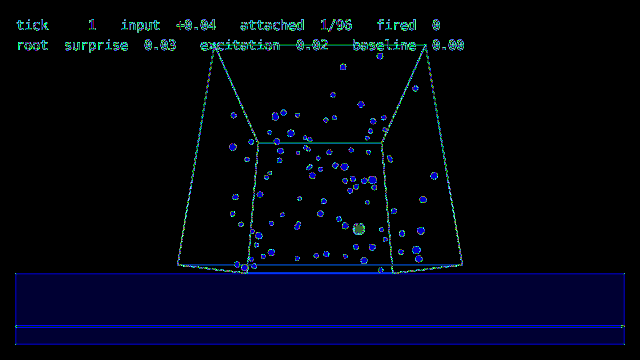

# Can spatially organized Silk networks regulate excitation and adapt to anomalous patterns in continuous signals?

Attention Fabric is a minimal-dependency Java research framework investigating whether local prediction error, excitation dynamics, and spatially organized directed connections can detect anomalies and support continuous-function approximation. Its units, called Silk, adapt their positions, form or prune connections, and generate coordinate-conditioned nonlinear outputs within a three-dimensional state space.

The central hypothesis is that Silk units regulate excitation by converging toward locally stable states. Normal signals reduce excitation and disturbance, whereas unfamiliar or anomalous activity produces a residual that can trigger a chain reaction of firing, recruitment, migration, and structural adaptation. If an initially anomalous pattern occurs repeatedly, the network adapts and reduces its response, recognizing that the pattern has become normal behavior.

The framework differs from a typical artificial neural network by investigating this homeostatic and structural adaptation rather than updating a fixed network through global parameter optimization. The network does not process anomalies as a separate category: anomaly is inferred from persistent excitation and prediction residual relative to a unit's adapted baseline.

Each Silk is a stateful unit in a three-dimensional state space. A unit receives an activity signal through receivers and emits a transformed signal through teeth. Directed connections join the teeth of one unit to the receivers of another, forming a loosely tree-structured network in which the signal is progressively transformed at each branch.

Each Silk has current excitation, baseline excitation, excitation gain, and a leakage rate. Incoming signals increase excitation according to gain, while leakage removes activity over time. As gain and leakage balance, excitation approaches a stable level, and the baseline adapts toward that level.

Prediction error, or surprise, is not the propagated signal. It is a residual control quantity that may alter excitation, firing, connection formation, and pruning. An unusually large residual indicates insufficient local adaptation and can trigger additional Silk units to receive and process the signal. Frequent repetition allows the local equilibrium and baseline to absorb the pattern, gradually reducing excitation, firing, and recruitment for it.

During network exploration, Silk units may migrate along randomized trajectories. Migration allows units to encounter new signal regions or connection partners. Excitation above the adapted baseline marks active exploration or weak local representation, while excitation below the baseline may mark weak or unproductive branches eligible for probabilistic pruning.

The gain, leakage, surprise, recruitment, pruning, and migration rules are implemented and tested. The experiments below evaluate which parts of the hypothesis hold and how the mechanism performs relative to established approaches. The complete account is in [manuscript/manuscript.md](manuscript/manuscript.md).

## Findings

Ten seeds were used for every stochastic configuration. All results are reproducible to the byte and are committed under `results/`.

- **Single unit.** Surprise under constant input fell from 1.000 to 0.014 in 20 ticks. A step change produced a surprise of 2.012, which fell to 10 percent of that value within 11 ticks. The response to a second change was delayed by one tick and the firing burst shortened from 13 ticks to 9 because the baseline had risen.
- **Anomaly response and habituation.** Under rare pulses every pulse elicited firing throughout the run. Under frequent pulses with a slow baseline ($\beta = 0.01$), firing probability at pulses declined from 0.614 to 0.471 over the run; with a fast baseline ($\beta = 0.2$) no decline occurred. Habituation requires a baseline time constant longer than the inter-stimulus interval. At the network level the firing cascade at rare pulses declined from 3.85 to 1.90 units, and the background sinusoid alone recruited two thirds of the pool before any pulse arrived.
- **Function approximation.** On four targets the full fabric achieved test errors between 0.070 and 0.188, between the affine baseline and fixed random features of the same family and capacity (0.00004 to 0.003). Replacing the root transform with the identity reduced fabric error by a factor of 3 to 10, identifying the root nonlinearity as the main limitation. Pruning reduced the active pool to between 23 and 37 units in some seeds and raised error above the affine baseline in those runs, because readout weights indexed by unit identity do not survive re-attachment.

The mechanism supports the anomaly-response component of the hypothesis and does not, in its present form, support the function-approximation component.

## Visualization



The recording shows a fabric of 96 units over 720 ticks from a camera orbiting the state space once. The background is a sinusoid of period 240 with Gaussian noise; an isolated pulse of amplitude 3.0 arrives at tick 180 and a train of pulses at interval 10 runs from tick 400 to tick 600. Attached units are drawn as discs whose radius and color follow excitation (blue at rest, through yellow, to red at three times the firing threshold), dormant units as small grey points, directed connections as lines from parent to child, the root with a thin outline, and units that fired on the current tick with a white ring. The panel at the bottom shows the most recent 200 inputs with pulses marked in red.

The isolated pulse produces a burst of firing at the root, which recruits nearby dormant units; the recruited units then fire on the transformed signal and recruit further. During the pulse train the cascades become smaller as baselines rise, leaves whose excitation falls below baseline are pruned and return to the pool, and excited units drift along random trajectories. The slow background period was chosen so that the expectation tracks it without firing, leaving recruitment to the pulses; with the period of 50 used in Experiment 2 the background alone recruits most of the pool before any pulse arrives, as reported in the manuscript.

The animation is rendered with the JDK alone, uses a fixed 128-color palette without dithering, and is byte-reproducible for a given seed.

```sh
./render-animation.sh          # writes media/attention-fabric.gif (seed 0)
./render-animation.sh 7        # different seed
FRAMES=1 ./render-animation.sh # writes 1280x720 PNG frames to media/frames/ instead
```

## Repository layout

```
fabric/src/main/java/greasenbrine/fabric/
  core/        Silk, SilkParameters, SilkTick, FabricParameters, SilkFabric
  learning/    LinearReadout, OnlineRegressor, baselines, FabricRegressor
  experiment/  SingleUnitExperiment, HabituationExperiment, ApproximationExperiment, ExperimentRunner
  visualization/ Camera, FrameRenderer, Palette, GifSequenceWriter, Demonstration, recorders
  structures/  Point
  math/        Matrix
fabric/src/test/java/   94 unit tests
results/                CSV outputs and environment record
media/                  demonstration animation
manuscript/             manuscript.md
```

## Reproduction

Requirements: JDK 26 or later (as set by `maven.compiler.release`) and Maven 3.

```sh
mvn -f fabric/pom.xml test      # run the unit tests
./run-experiments.sh            # run all experiments; writes results/ (about 30 s)
./run-experiments.sh 20         # same, with 20 seeds
```

Model and structural parameters are recorded in `results/environment.txt` after each run.


